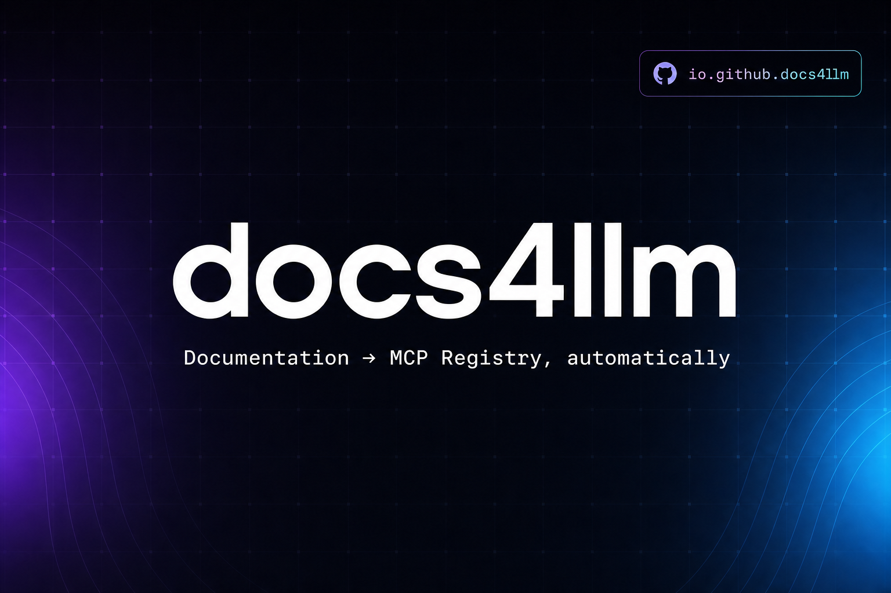

<div align="center">

# docs4llm

### Documentation infrastructure for AI agents

**Paste any docs URL → get a hosted, Cursor-ready MCP server in under 60 seconds.**

No install. No local clone. No API keys to hand over.



[**Live**](https://docs4llm.site) · [Docs](https://github.com/dipesh4000/docs4llm/tree/main/docs) · [Pricing](https://docs4llm.site/pricing) · [Comparison](https://docs4llm.site/comparison)

[](https://github.com/dipesh4000/docs4llm/stargazers)
[](https://nextjs.org)
[](https://tinyfish.ai)
[](https://openrouter.ai)
[](https://modelcontextprotocol.io)
[](https://registry.modelcontextprotocol.io/?search=docs4llm)
[](https://www.npmjs.com/package/docs4llm)
[](https://github.com/dipesh4000/docs4llm/pulls)
[](#license)

**If docs4llm is useful to you, please [⭐ star the repo](https://github.com/dipesh4000/docs4llm) — it helps other developers find it.**

</div>

---

## 📚 Project Documentation Hub

Comprehensive architectural specs, pipeline internals, and integration guides are located in the [`docs/`](https://github.com/dipesh4000/docs4llm/tree/main/docs) directory:

| Guide | Description |
|---|---|
| **[Architecture & System Design](https://github.com/dipesh4000/docs4llm/blob/main/docs/ARCHITECTURE.md)** | Subsystems, data flow, multi-tenancy, and runtime mechanics. |
| **[5-Stage Pipeline Specification](https://github.com/dipesh4000/docs4llm/blob/main/docs/PIPELINE_SPEC.md)** | Step-by-step breakdown of URL-to-MCP transformation. |
| **[TinyFish Crawler Integration](https://github.com/dipesh4000/docs4llm/blob/main/docs/TINYFISH_INTEGRATION.md)** | Autonomous agentic web crawling, SPA hydration, and anti-bot bypass. |
| **[Model Context Protocol (MCP) Spec](https://github.com/dipesh4000/docs4llm/blob/main/docs/MCP_SPEC.md)** | JSON-RPC 2.0 schemas, standard tools, custom API tools, and IDE setup. |
| **[Database Schema & Data Model](https://github.com/dipesh4000/docs4llm/blob/main/docs/DATABASE_SCHEMA.md)** | PostgreSQL / Drizzle ORM entities and database migrations. |
| **[Platform REST API Reference](https://github.com/dipesh4000/docs4llm/blob/main/docs/API_REFERENCE.md)** | REST endpoints for conversions, polling status, and CLI auth. |
| **[CLI Tool Reference](https://github.com/dipesh4000/docs4llm/blob/main/docs/CLI_REFERENCE.md)** | Global terminal client (`npm i -g docs4llm`) and automated editor configuration. |
| **[Developer & Contributor Guide](https://github.com/dipesh4000/docs4llm/blob/main/docs/DEVELOPER_GUIDE.md)** | Local environment setup, environment variables, and testing. |

---

## How It Works

```
[Docs URL] ──► [Source Detector] ──► [TinyFish Autonomous Crawler] ──► [Heading BM25 + OpenRouter AI] ──► [Hosted MCP Server]
```

1. **Paste a Docs URL**: LangChain, Stripe, Mintlify, GitBook, Nextra, OpenAPI specs, or GitHub repos.
2. **Autonomous Agent Crawl (TinyFish)**: The TinyFish cloud agent executes client-side JavaScript, bypasses bot protections, and captures clean GitHub-Flavored Markdown.
3. **Semantic Indexing & AI Analysis**:
   - **ATX Heading Chunking**: Splits sections hierarchically while retaining full ancestor breadcrumb trails.
   - **BM25+ Lexical Scorer**: Delivers sub-10ms keyword and exact code-identifier search.
   - **OpenRouter AI Analysis**: Deduplicates API endpoints, detects auth patterns, infers workflows, and generates standardized `llms.txt`.
4. **Instant MCP Server**: Serves a secure, bearer-token authenticated Streamable HTTP endpoint at `/api/mcp/{id}/mcp`.
5. **Direct Editor Connection**: Plugs straight into Cursor, Claude Desktop, VS Code, Windsurf, and agent frameworks like LangChain.

```json
{
  "mcpServers": {
    "stripe": {
      "url": "https://docs4llm.site/api/mcp/<projectId>/mcp",
      "headers": {
        "Authorization": "Bearer <project-token>"
      }
    }
  }
}
```

---

## 🛠️ CLI Quick Start

Install the terminal client and run conversions straight from your shell:

```bash
# Global install (puts `docs4llm` on your PATH)
npm install -g docs4llm

# Authorize with your account
docs4llm login

# Convert docs and auto-install into your editor
docs4llm https://docs.stripe.com
```

- 📦 npm: https://www.npmjs.com/package/docs4llm
- 📖 Full command reference: [`docs/CLI_REFERENCE.md`](https://github.com/dipesh4000/docs4llm/blob/main/docs/CLI_REFERENCE.md)

---

## 🧰 MCP Tools Generated Per Project

| Tool | What It Does |
|---|---|
| `list_documentation_pages` | Lists all crawled pages, titles, and paths |
| `get_documentation_page` | Retrieves full markdown of a specific page |
| `search_documentation` | Sub-10ms heading-aware BM25+ search with breadcrumbs |
| `get_documentation_overview` | Summary of the platform, auth guides, and `llms.txt` |
| `read_full_documentation` | All pages combined for frontier models |
| `ask_documentation` | Natural-language Q&A powered by OpenRouter with source citations |
| *Custom API Tools* | Up to 10 compressed tools synthesized from detected endpoints |

---

## 🏗️ Tech Stack

| Layer | Technology |
|---|---|
| Framework | Next.js 16 (App Router, React 19, Turbopack) |
| Web Crawler | TinyFish Agent API (`@tiny-fish/sdk`) |
| AI / LLM | OpenRouter (`nvidia/nemotron-3-ultra-550b-a55b:free` default) |
| Search Engine | In-Memory Heading-Aware BM25+ |
| Database | Supabase Postgres via Drizzle ORM |
| Auth | Supabase Auth (GitHub OAuth) |
| Protocol | `@modelcontextprotocol/sdk` (Streamable HTTP / JSON-RPC 2.0) |
| UI | Tailwind CSS v4, shadcn/ui, Framer Motion |
| Cache & Queue | Upstash Redis + QStash |

---

## 💻 Local Development

```bash
# 1. Clone repository
git clone https://github.com/dipesh4000/docs4llm.git
cd docs4llm

# 2. Install dependencies
pnpm install

# 3. Configure environment variables
cp .env.example .env.local

# 4. Push database schema
pnpm db:push

# 5. Start development server
pnpm dev
```

Open <http://localhost:3000>.

### Environment Variables

```env
# Application
NEXT_PUBLIC_APP_URL="http://localhost:3000"
AUTH_SECRET="..."                 # openssl rand -base64 32

# Crawler Engine (TinyFish)
TINYFISH_API_KEY="..."            # https://agent.tinyfish.ai/api-keys

# AI Analysis (OpenRouter)
OPENROUTER_API_KEY="..."          # https://openrouter.ai/keys
OPENROUTER_MODEL="nvidia/nemotron-3-ultra-550b-a55b:free"

# Supabase Postgres Database
POSTGRES_URL="..."
NEXT_PUBLIC_SUPABASE_URL="..."
NEXT_PUBLIC_SUPABASE_ANON_KEY="..."
SUPABASE_SERVICE_ROLE_KEY="..."

# GitHub OAuth
GITHUB_CLIENT_ID="..."
GITHUB_CLIENT_SECRET="..."
```

---

## 🤝 Contributing

Contributions are welcome! Please see the [Developer & Contributor Guide](https://github.com/dipesh4000/docs4llm/blob/main/docs/DEVELOPER_GUIDE.md) and [CONTRIBUTING.md](https://github.com/dipesh4000/docs4llm/blob/main/CONTRIBUTING.md) for guidelines.

Found a bug or have an idea? [Open an issue](https://github.com/dipesh4000/docs4llm/issues).

---

## 🔒 Security

Never commit secrets — all API keys belong in `.env.local` (gitignored). If you discover a security issue, please open a [private security advisory](https://github.com/dipesh4000/docs4llm/security/advisories/new).

---

## 📄 License

[Apache 2.0](./LICENSE)
