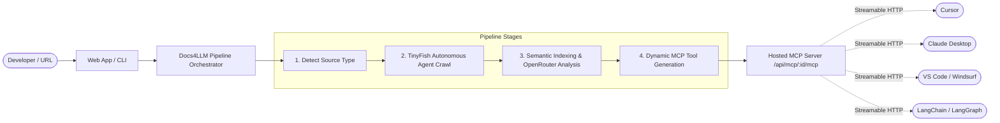

# System Architecture & Technical Design

## 1. Executive Overview

**Docs4LLM** converts technical documentation into machine-queryable, hosted [Model Context Protocol (MCP)](https://modelcontextprotocol.io) servers. 

Rather than requiring developers to copy-paste snippets or letting AI coding assistants hallucinate deprecated APIs, Docs4LLM provides a zero-setup pipeline that extracts, indexes, and serves documentation directly to AI agents inside their IDEs and runtime environments.



---

## 2. Core Architecture Subsystems

### Subsystem 1: Ingestion & Source Detection
- **File Location:** [`lib/docs4llm/detect-source-type.ts`](file:///home/nithin/Projects/docs4llm/lib/docs4llm/detect-source-type.ts)
- **Role:** Inspects input URLs to detect framework signatures:
  - Mintlify (`mintlify.com`, `docs.json`, `mint.json`)
  - GitBook (`gitbook.io`, `__gitbook_` tags)
  - Docusaurus (`docusaurus` markers, `sitemap.xml`)
  - Nextra / Next.js Docs
  - OpenAPI / Swagger (`openapi.json`, `swagger.yaml`)
  - GitHub Repositories (`github.com/owner/repo`)
  - Plain HTML / Markdown files

### Subsystem 2: Autonomous Agentic Crawling (TinyFish)
- **File Location:** [`services/ingestion/`](file:///home/nithin/Projects/docs4llm/services/ingestion/)
- **Engine:** Powered by the **TinyFish Agent API** (`@tiny-fish/sdk`).
- **Why TinyFish?**
  - **Dynamic SPA Hydration:** Modern docs rely on client-side React/Vue rendering. TinyFish executes JavaScript in a cloud headless browser and waits for network idle.
  - **Anti-Bot Defense:** Bypasses Cloudflare, CAPTCHAs, and bot protection blocks automatically.
  - **Clean Output:** Strips away layout noise (navbars, ads, cookie popups, sticky footers) and returns clean, structured Markdown.
- **Output:** Standardized `CrawlResult[]` array containing URL, page title, section type, and clean markdown content.

### Subsystem 3: Semantic Indexing & AI Analysis (Option D: Hybrid)
- **File Location:** [`lib/docs4llm/chunks.ts`](file:///home/nithin/Projects/docs4llm/lib/docs4llm/chunks.ts), [`services/ai/understanding.ts`](file:///home/nithin/Projects/docs4llm/services/ai/understanding.ts)
- **Why Hybrid Indexing?**
  - Vector-only search often fails on exact code identifiers, method names (e.g. `client.auth.getUser()`), and HTTP error codes.
  - Plain keyword search fails on natural-language synonyms.
  - Docs4LLM combines:
    1. **Heading-Aware ATX Chunking:** Divides docs into 1,200–1,500 char sections with full ancestor breadcrumbs (`Auth > Tokens > Refresh`).
    2. **BM25+ Weighted Lexical Search:** Highly tuned weights prioritizing headings ($W=6$), page titles ($W=4$), breadcrumbs ($W=2$), and exact code symbols ($+5$ bonus).
    3. **OpenRouter AI Analysis:** One-shot analysis extracting structured API endpoints, authentication schemes, multi-step agent recipes, and generating `llms.txt`.

### Subsystem 4: Dynamic MCP Server Engine
- **File Location:** [`lib/docs4llm/mcp-tools-runtime.ts`](file:///home/nithin/Projects/docs4llm/lib/docs4llm/mcp-tools-runtime.ts), [`app/api/mcp/[id]/mcp/route.ts`](file:///home/nithin/Projects/docs4llm/app/api/mcp/[id]/mcp/route.ts)
- **Protocol:** Model Context Protocol (MCP) Streamable HTTP transport (JSON-RPC 2.0).
- **Core Standard Tools Provided:**
  - `list_documentation_pages`: Lists page tree and metadata.
  - `get_documentation_page`: Fetches the complete markdown of a single page.
  - `search_documentation`: Sub-10ms heading-aware BM25 search.
  - `get_documentation_overview`: Returns system summary, auth guide, and `llms.txt`.
  - `ask_documentation`: Question answering with cited page references.
- **Synthesized Custom Tools:** Up to 10 compressed API tools dynamically generated for the specific service (e.g., `create_customer`, `send_notification`).

### Subsystem 5: Multi-Surface Client Delivery
1. **Web Dashboard (`app/convert`)**: Visual conversion UI with live status indicators and copy-paste editor configuration blocks.
2. **npm CLI (`packages/cli`)**: Single-step terminal setup:
   ```bash
   npx docs4llm add https://docs.stripe.com
   ```
   Automatically edits local configuration files for Cursor (`.cursor/mcp.json`), Claude Desktop (`claude_desktop_config.json`), and VS Code.
3. **TypeScript SDK (`@docs4llm/sdk`)**: Programmatic API for CI/CD pipelines, autonomous agent swarms, and backend servers.

---

## 3. Data Flow & State Lifecycle

Every documentation conversion transitions through a deterministic state machine:

```
[QUEUED] 
   │
   ▼
[CRAWLING] (TinyFish Agent navigates site & generates Markdown)
   │
   ▼
[INDEXING] (ATX heading split, BM25 index built, chunk caches created)
   │
   ▼
[ANALYZING] (OpenRouter discovers endpoints, workflows, llms.txt)
   │
   ▼
[READY] (MCP endpoint active at /api/mcp/{id}/mcp with Bearer token)
   │
   ▼ (On failure)
[FAILED] (Detailed error message logged; graceful fallback attempted)
```

---

## 4. Multi-Tenancy & Security Architecture

- **Per-Project Isolation:** Each project generates an independent bearer token (`d4l_live_...`).
- **No Shared Credentials:** Even if multiple users convert the same public documentation, their MCP server endpoints and token scopes remain completely isolated.
- **Read-Only Guarantees:** By default, documentation tools are strictly read-only and safe for autonomous agent execution without prompt injection risks.
- **Rate Limiting:** Managed at the API edge via Upstash Redis (with in-memory fallbacks when Redis is unconfigured).

---

## 5. Technology Stack Summary

| Component | Technology | Rationale |
|---|---|---|
| Framework | Next.js 16 (App Router, Turbopack) | Fast serverless execution and edge rendering |
| Language | TypeScript 5.6+ (Strict mode) | End-to-end type safety |
| Crawler | TinyFish Agent API (`@tiny-fish/sdk`) | Headless dynamic SPA exploration & anti-bot bypass |
| Search Index | In-Memory Heading-Aware BM25+ | Instant exact symbol retrieval without external vector DB |
| AI Reasoning | OpenRouter (Nemotron, Claude, GPT-4o-mini) | High-speed structured analysis and schema synthesis |
| Database | Supabase Postgres via Drizzle ORM | Light, type-safe schema and migration layer |
| MCP SDK | `@modelcontextprotocol/sdk` | Official JSON-RPC 2.0 protocol implementation |
| Styling | Tailwind CSS v4 | High-performance modern utility styling |
