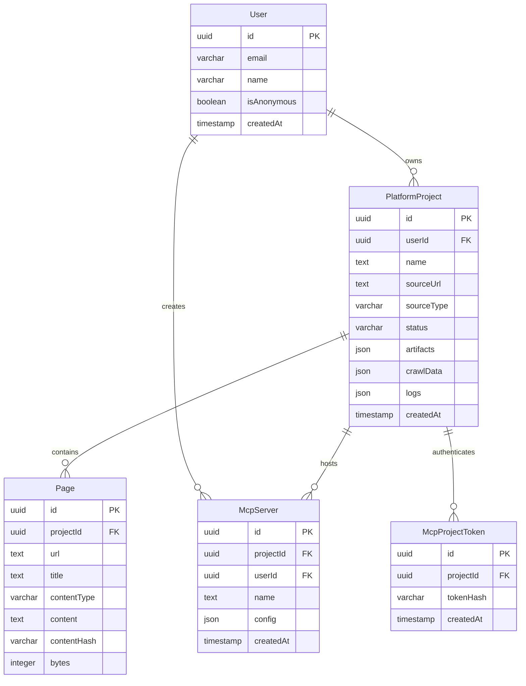

# Database Schema & Data Dictionary

This document specifies the PostgreSQL relational database schema for **Docs4LLM**, managed via [Drizzle ORM](https://orm.drizzle.team) on top of [Supabase](https://supabase.com).

The schema definitions are located in [`lib/db/schema.ts`](https://github.com/dipesh4000/docs4llm/blob/main/lib/db/schema.ts).

---

## 1. Entity-Relationship Overview



---

## 2. Table Specifications

### 2.1 `PlatformProject`
The core record representing a converted documentation site.

| Column | Type | Constraints | Description |
|---|---|---|---|
| `id` | `UUID` | `PRIMARY KEY`, default random | Unique project identifier |
| `userId` | `UUID` | `NOT NULL`, `REFERENCES User(id)` | Owning user account |
| `name` | `TEXT` | `NOT NULL` | Project or docs name (e.g. "Stripe Docs") |
| `sourceUrl` | `TEXT` | `NULLABLE` | Documentation root URL |
| `sourceType` | `VARCHAR` | `NOT NULL` | `url`, `github`, `markdown`, `openapi`, `postman`, `html`, `gitbook` |
| `status` | `VARCHAR` | `NOT NULL`, default `pending` | `pending`, `crawling`, `analyzing`, `generating`, `ready`, `error` |
| `artifacts` | `JSONB` | `NULLABLE` | Output of OpenRouter analysis (`endpoints`, `workflows`, `llmsTxt`, `compressedTools`) |
| `crawlData` | `JSONB` | `NULLABLE` | Array of `CrawlResult` pages extracted by TinyFish |
| `logs` | `JSONB` | `NULLABLE` | Array of `ProcessingLog` entries capturing pipeline milestones |
| `tokenUsage` | `JSONB` | `NULLABLE` | Token breakdown for prompt, completion, and total AI usage |
| `source` | `VARCHAR` | `NOT NULL`, default `web` | Origin of conversion (`web` or `cli`) |
| `createdAt` | `TIMESTAMP`| `NOT NULL`, default now | Creation timestamp |
| `updatedAt` | `TIMESTAMP`| `NOT NULL`, default now | Last updated timestamp |

---

### 2.2 `Page`
Individual documentation pages extracted by the crawler for persistent page-level lookup.

| Column | Type | Constraints | Description |
|---|---|---|---|
| `id` | `UUID` | `PRIMARY KEY` | Unique page record ID |
| `projectId` | `UUID` | `NOT NULL`, `REFERENCES PlatformProject(id)` | Associated project |
| `url` | `TEXT` | `NOT NULL` | Canonical subpage URL |
| `title` | `TEXT` | `NOT NULL` | Page title |
| `contentType` | `VARCHAR` | `NOT NULL`, default `page` | `api`, `auth`, `workflow`, or `page` |
| `content` | `TEXT` | `NOT NULL` | Complete cleaned Markdown text |
| `contentHash` | `VARCHAR` | `NULLABLE` | SHA-256 hash for deduplication |
| `bytes` | `INTEGER` | `NULLABLE` | Size in bytes |

---

### 2.3 `McpServer`
The hosted Model Context Protocol server configuration.

| Column | Type | Constraints | Description |
|---|---|---|---|
| `id` | `UUID` | `PRIMARY KEY` | Unique MCP server ID |
| `projectId` | `UUID` | `NOT NULL`, `REFERENCES PlatformProject(id)` | Associated project |
| `userId` | `UUID` | `NOT NULL`, `REFERENCES User(id)` | Owning user |
| `name` | `TEXT` | `NOT NULL` | Server identifier name |
| `config` | `JSONB` | `NOT NULL` | Tool schemas, server metadata, and routing configuration |
| `createdAt` | `TIMESTAMP`| `NOT NULL`, default now | Creation timestamp |

---

### 2.4 `McpProjectToken`
Bearer authentication tokens for accessing the `/api/mcp/{id}/mcp` endpoint.

| Column | Type | Constraints | Description |
|---|---|---|---|
| `id` | `UUID` | `PRIMARY KEY` | Unique token ID |
| `projectId` | `UUID` | `NOT NULL`, `REFERENCES PlatformProject(id)` | Target project |
| `tokenHash` | `VARCHAR` | `NOT NULL` | SHA-256 hash of the bearer token (`d4l_live_...`) |
| `revoked` | `BOOLEAN` | `NOT NULL`, default `false` | Whether token is revoked |
| `createdAt` | `TIMESTAMP`| `NOT NULL`, default now | Creation timestamp |

---

## 3. Database Migrations & Commands

Docs4LLM uses Drizzle Kit to manage schema synchronization:

```bash
# Push schema changes directly to Supabase Postgres (Development)
pnpm db:push

# Generate SQL migration scripts
pnpm db:generate

# Execute pending migrations
pnpm db:migrate
```
