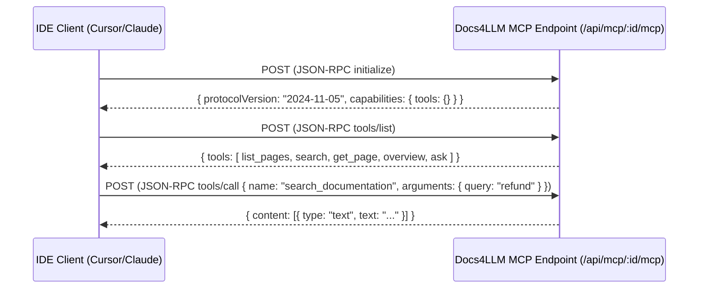

# Model Context Protocol (MCP) Server Specification

This document details the **Model Context Protocol (MCP)** implementation in Docs4LLM, including transport mechanics, tool schemas, authentication, and client IDE configurations.

---

## 1. Protocol Architecture & Transport

Docs4LLM implements the official Model Context Protocol (MCP) using Streamable HTTP (JSON-RPC 2.0).

- **Endpoint URL:** `POST https://docs4llm.site/api/mcp/{projectId}/mcp`
- **Protocol Version:** `2024-11-05`
- **Authentication:** HTTP Bearer token via `Authorization: Bearer d4l_live_<token>`



---

## 2. Standard Universal Documentation Tools

Every generated Docs4LLM server provides 5 foundational tools out of the box:

### 1. `list_documentation_pages`
Enumerates all indexed pages with their URLs, titles, and brief excerpts.
* **Input Schema:**
  ```json
  {
    "type": "object",
    "properties": {},
    "additionalProperties": false
  }
  ```
* **Output:** An array of page objects with `id`, `url`, `title`, and `type`.

---

### 2. `get_documentation_page`
Retrieves the full Markdown content of a specific page.
* **Input Schema:**
  ```json
  {
    "type": "object",
    "properties": {
      "url": { "type": "string", "description": "The exact page URL to fetch" },
      "id": { "type": "string", "description": "Optional page ID" }
    },
    "additionalProperties": false
  }
  ```
* **Output:** Complete Markdown string with code blocks and headers intact.

---

### 3. `search_documentation`
Performs a fast, heading-aware BM25+ search returning ranked snippets and anchor links.
* **Input Schema:**
  ```json
  {
    "type": "object",
    "properties": {
      "query": { "type": "string", "description": "Search terms or code identifier" },
      "limit": { "type": "integer", "description": "Max results to return (default: 5)" }
    },
    "required": ["query"],
    "additionalProperties": false
  }
  ```
* **Output:** Ranked snippets with breadcrumb trails (e.g. `Auth > API Keys`), scores, and citation links.

---

### 4. `get_documentation_overview`
Returns the high-level architecture overview, authentication patterns, inferred workflows, and standard `llms.txt`.
* **Input Schema:**
  ```json
  {
    "type": "object",
    "properties": {},
    "additionalProperties": false
  }
  ```
* **Output:** Markdown summary of the system, auth steps, and machine index.

---

### 5. `ask_documentation`
Answers technical questions directly using OpenRouter with mandatory citations back to documentation pages.
* **Input Schema:**
  ```json
  {
    "type": "object",
    "properties": {
      "question": { "type": "string", "description": "Natural language question" }
    },
    "required": ["question"],
    "additionalProperties": false
  }
  ```
* **Output:** Cited markdown response referencing exact URLs for verification.

---

## 3. Dynamically Synthesized Custom API Tools

When Docs4LLM detects an API reference or OpenAPI specification, it synthesizes up to 10 compressed custom tools (e.g., `create_customer`, `trigger_webhook`, `get_billing_usage`).
- Each tool contains exact parameter validation (`type`, `description`, `required`).
- Tools contain usage guidelines and authentication requirements in their descriptions to guide agent execution.

---

## 4. IDE Client Configuration Guide

### Cursor Configuration
Add to `.cursor/mcp.json` or Cursor Settings → MCP:
```json
{
  "mcpServers": {
    "my-docs": {
      "url": "https://docs4llm.site/api/mcp/proj_123/mcp",
      "headers": {
        "Authorization": "Bearer d4l_live_abc123xyz"
      }
    }
  }
}
```

### Claude Desktop Configuration
Add to `claude_desktop_config.json`:
```json
{
  "mcpServers": {
    "my-docs": {
      "command": "npx",
      "args": [
        "-y",
        "mcp-remote",
        "https://docs4llm.site/api/mcp/proj_123/mcp",
        "--header",
        "Authorization: Bearer d4l_live_abc123xyz"
      ]
    }
  }
}
```

### VS Code / Windsurf
Add to your editor's MCP server configuration:
```json
{
  "mcpServers": {
    "my-docs": {
      "type": "http",
      "url": "https://docs4llm.site/api/mcp/proj_123/mcp",
      "headers": {
        "Authorization": "Bearer d4l_live_abc123xyz"
      }
    }
  }
}
```

### LangChain / LangGraph Python Client
```python
from mcp import ClientSession
from mcp.client.sse import sse_client

async with sse_client(
    "https://docs4llm.site/api/mcp/proj_123/mcp",
    headers={"Authorization": "Bearer d4l_live_abc123xyz"}
) as (read, write):
    async with ClientSession(read, write) as session:
        await session.initialize()
        tools = await session.list_tools()
        print("Available tools:", [t.name for t in tools.tools])
```
