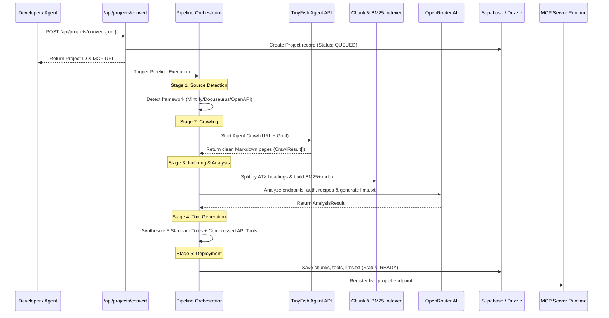

# Pipeline Specification: 5-Stage URL-to-MCP Pipeline

This specification defines the 5-stage transformation pipeline that converts a raw documentation URL into an active, authenticated Model Context Protocol (MCP) server.

---

## Pipeline Overview



---

## Stage 1: Ingestion & Source Detection

### Goal
Determine whether the target URL is a standard documentation website, a single raw Markdown file, an OpenAPI definition, or a Git repository.

### Detection Rules
1. **GitHub Repository**: Match regex `/github\.com\/([^/]+)\/([^/]+)/`. Routes to repo tree extraction.
2. **OpenAPI / Swagger**: Checks for `/openapi\.(json|yaml|yml)/` or `swagger.json` in path or body.
3. **Doc Frameworks**:
   - Mintlify: Checks for `mint.json`, `docs.json`, or `mintlify` script tags.
   - Docusaurus: Checks for `docusaurus-plugin` or `sitemap.xml`.
   - GitBook: Checks for `gitbook.io` or `__gitbook_` attributes.
   - Nextra: Checks for `nextra` theme markers.
4. **Fallback**: Standard documentation website.

---

## Stage 2: Autonomous Agent Crawling (TinyFish)

### Goal
Extract complete technical content across all subpages as clean, unpolluted Markdown while navigating SPAs and bypassing anti-bot challenges.

### Operation
- Docs4LLM dispatches a goal-driven task to the **TinyFish Agent API** (`@tiny-fish/sdk`):
  - **Input:** Target URL, exploration budget (max 40 pages for serverless performance).
  - **Goal:** `"Explore the documentation sidebar, read all guide and API pages, and extract clean markdown."`
- **Output Schema (`CrawlResult`):**
  ```typescript
  export type CrawlResult = {
    url: string;               // Canonical URL of the page
    title: string;             // Page heading / Title
    content: string;           // Clean GitHub-Flavored Markdown
    type: "api" | "auth" | "workflow" | "page"; // Categorized page type
    contentHash?: string;      // SHA-256 hash for caching
  };
  ```

---

## Stage 3: Semantic Indexing & AI Analysis (Option D: Hybrid)

### Part A: Heading-Aware Document Chunking
Raw Markdown files are parsed hierarchically rather than split by arbitrary character counts:
- **ATX Splitter:** Cuts at `#`, `##`, `###`, `####` headers.
- **Ancestor Breadcrumbs:** Every chunk stores its full hierarchy path:
  `"Billing > Subscriptions > Cancellation Flow"`
- **Atomic Code Protection:** Fenced code blocks (```` ``` ````) are never broken across chunk boundaries.
- **Chunk Parameters:**
  - Target size: 1,200–1,500 characters.
  - Minimum size: 300 characters.
  - Overlap: 150 characters.

### Part B: In-Memory BM25+ Scorer
Provides instant (< 10ms), deterministic exact-token search:
$$\text{Score}(Q, C) = \sum_{t \in Q} \Big[ W_{\text{field}}(t, C) \cdot \text{len}(t) \Big] + \text{Bonus}_{\text{type}}$$
- Heading matches: $+6$ + term length.
- Title matches: $+4$ + term length.
- Breadcrumb matches: $+2$.
- Exact code identifier matches: $+5$ bonus.
- API reference page boost: $+2$ bonus.

### Part C: OpenRouter AI Intelligence Engine
A batch prompt passes sampled documentation slices to OpenRouter:
- **Endpoint Extraction:** Discovers HTTP verbs, paths, parameter types, and descriptions.
- **Deduplication:** Groups duplicate endpoint references into canonical operations.
- **Auth Pattern Extraction:** Discovers bearer tokens, API keys, basic auth, or OAuth2.
- **Workflow Detection:** Detects multi-step recipes and customer journeys.
- **`llms.txt` Generation:** Synthesizes standard `/llms.txt` and `/llms-full.txt` files.

---

## Stage 4: Dynamic Tool Synthesis & Compression

### Goal
Expose structured MCP tools to the AI assistant without exhausting its context window.

### Tool Strategy
1. **5 Standard Core Tools:**
   - `list_documentation_pages`: Returns titles, URLs, and summaries.
   - `get_documentation_page`: Retrieves full markdown for a URL.
   - `search_documentation`: Returns top BM25+ scored snippets with exact anchor links.
   - `get_documentation_overview`: Returns system overview, auth instructions, and `llms.txt`.
   - `ask_documentation`: OpenRouter Q&A with mandatory citations.
2. **Compressed Custom API Tools (Up to 10):**
   - Automatically clusters 50+ endpoints into high-level tools (e.g. `manage_users`, `execute_payment`).

---

## Stage 5: Endpoint Hosting & Runtime Dispatch

### Goal
Provide an authenticated, standard Model Context Protocol server over HTTP.

- **Route:** `POST /api/mcp/{projectId}/mcp`
- **Transport:** Streamable HTTP (JSON-RPC 2.0).
- **Security:** Requires header `Authorization: Bearer d4l_live_...`.
- **Status Lifecycle:** Project status updates to `READY`.
